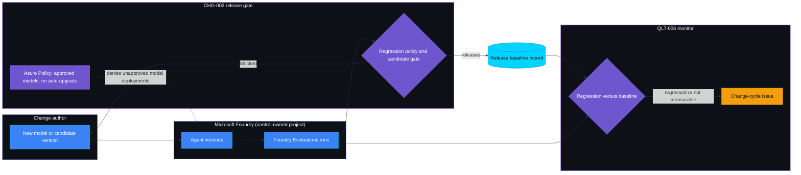

# Change, release and evaluation controls: architecture notes

> Living design notes for `controls/change_release_and_evaluation/`. Read
> this before assessing or implementing any control in this category, so a
> new control does not redefine or duplicate territory another control
> already claims.

## Table of contents

- [Status](#status)
- [Why this file exists](#why-this-file-exists)
- [Running example](#running-example)
- [The release baseline record](#the-release-baseline-record)
- [Data flow](#data-flow)
- [Scope boundaries between change controls](#scope-boundaries-between-change-controls)
- [Deliberate code duplication](#deliberate-code-duplication)
- [Known duplication risks to check during future assessments](#known-duplication-risks-to-check-during-future-assessments)
- [Revision log](#revision-log)

## Status

| Control | Decision | Reads | Writes | Status |
|---|---|---|---|---|
| [CHG-002](CHG-002_model_version_changed_without_regression_test/README.md) model version changed without regression test | Release or block a candidate model | Foundry Evaluations runs (baseline and candidate) | Release baseline record | Validated |
| [QLT-006](QLT-006_production_evaluation_regression/README.md) production evaluation regression | Live agent within tolerance, regressed, or not measurable | Release baseline record; Foundry Evaluations run (live version) | Change-cycle issue | Validated |
| CHG-001 unapproved prompt change | — | — | — | Planned |
| CHG-003 knowledge source changed without validation | — | — | — | Planned |
| CHG-004 guardrail regression | — | — | — | Planned |
| EVAL-PRE-001, EVAL-PRE-002, EVAL-PRE-004 | — | — | — | Planned |
| REL-PRE-001, REL-PRE-002 | — | — | — | Planned |

## Why this file exists

CHG-002 and QLT-006 form one story about the same agent: **no model change
without a regression test, and keep measuring after the release.** They
share one agent, one evaluation dataset and one baseline, but they make
different decisions, at different times, for different owners. This file
records what they share and where each one stops.

## Running example

A synthetic support assistant (`chg-002-support-assistant`) answers order and
refund questions with read-only tools. It is a Foundry prompt agent in a
control-owned Foundry account and project created by CHG-002. Each change to
its model creates a new agent version.

## The release baseline record

One JSON file, written by CHG-002 only when a candidate is released:

| Field | Meaning |
|---|---|
| `agent` | Agent name and the released agent version |
| `model` | Model asset ID including version, and the deployment name |
| `dataset` | Path and SHA-256 of the evaluation dataset |
| `evaluators` | Required built-in evaluators |
| `passRates` | Pass rate per evaluator measured at release |
| `evaluationRunId` | The Foundry Evaluations run that produced the pass rates |
| `releasedAt`, `contractSha256` | When, and under which contract |

QLT-006 reads this record by path and verifies its SHA-256 against its own
contract entry, so each contract entry stays self-contained, as
[`docs/governance-contract.md`](../../docs/governance-contract.md) requires.
QLT-006 never writes the record and never computes a second baseline.

## Data flow

Purple nodes are governance decisions, blue nodes are the agent and
Foundry, cyan is the shared evidence, amber is the governance action.

**Deployment order:** shared `infra/` (only for the subscription and
resource group conventions), then CHG-002 (account, project, models, agent,
Azure Policy), then QLT-006 (no Azure resources of its own; it creates and
deletes only its own evaluation objects).

## Scope boundaries between change controls

| Change | Governed by | Not governed by |
|---|---|---|
| Different model or model version for the agent | CHG-002 (before release) | — |
| Model deployment set to upgrade automatically | CHG-002 (Azure Policy denial) | — |
| Instructions edited | CHG-001 (planned) | CHG-002 ignores instruction-only changes; QLT-006 may detect their effect afterwards |
| Knowledge source changed | CHG-003 (planned) | — |
| Guardrail or content filter changed | CHG-004 (planned) | — |
| Quality drops after release, whatever the cause | QLT-006 | — |
| Absolute production groundedness rate | QLT-001 | QLT-006 compares with a baseline, not an absolute threshold |

When the agent optimizer promotes a candidate that changes both the model
and the instructions, CHG-002 evaluates the whole candidate version but
records only the model change as its decision subject.

## Deliberate code duplication

CHG-002 and QLT-006 both start a Foundry Evaluations run against an agent
version. Each control keeps its own small evaluation module. The repository
rule is to avoid shared abstractions until at least two *other* implemented
controls need the same one; revisit when CHG-001, CHG-003 or CHG-004 are
implemented.

## Known duplication risks to check during future assessments

- **CHG-001, CHG-003, CHG-004:** reuse the release baseline record and the
  same evaluation dataset rather than inventing a parallel baseline.
- **EVAL-PRE-001/002:** own whether an evaluation dataset exists and covers
  requirements; CHG-002 assumes a dataset is present and only checks its
  hash.
- **REL-PRE-001/002:** own the release evidence pack and go-live approval;
  CHG-002's evidence is one input to that pack, not a replacement.
- **QLT-001:** keep absolute thresholds there; QLT-006 stays relative.

## Revision log

| Date | Control | Change |
|---|---|---|
| 2026-11-26 | CHG-002, QLT-006 | File created with both assessments. Defines the release baseline record, the scope boundaries and the deployment order. |
| 2026-11-26 | CHG-002, QLT-006 | Both validated live end to end, including verified cleanup. The release baseline record is now local per environment (git-ignored, removed by CHG-002 cleanup), because it cites Foundry runs that cleanup deletes. |
