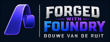
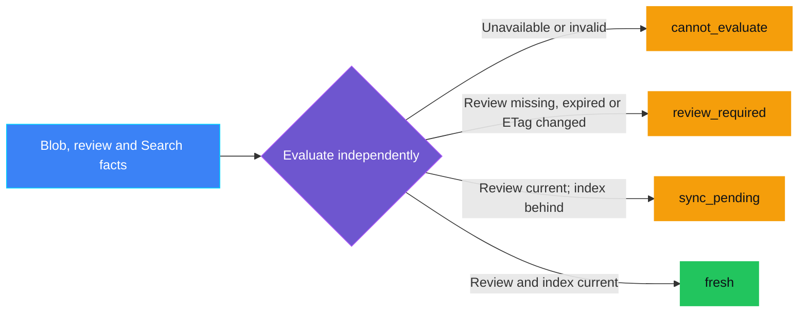
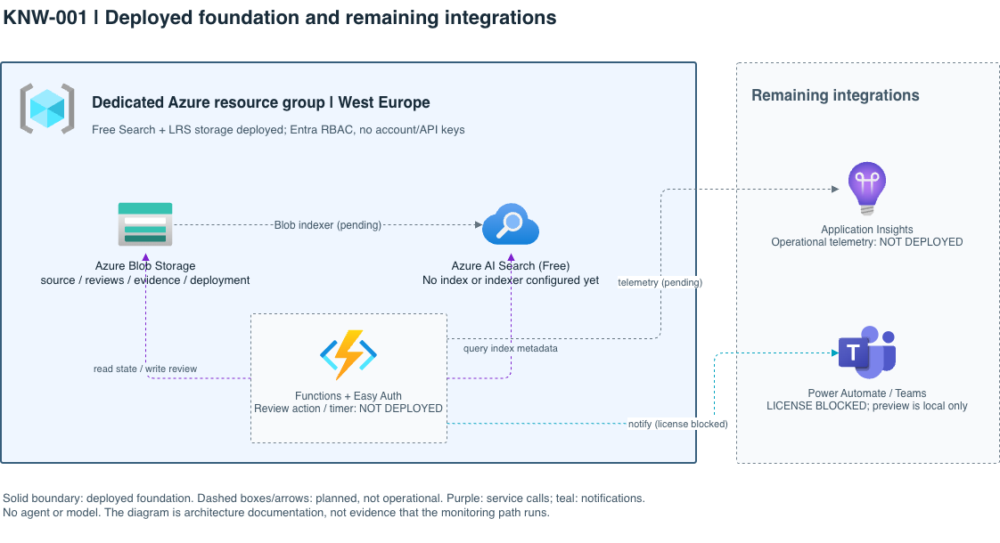

<p align="center">
    
</p>

# KNW-001 — Knowledge freshness breach

> **Status:** Planned — the Blob/Search foundation is deployed; local policy tests and the synthetic chat preview run. No indexer, authenticated review endpoint, scheduled Function, or Teams sender exists yet.
>
> **Last reviewed:** 2026-10-27. See [captured validation](docs/VALIDATION.md).

## Table of contents

* [Overview](#overview)
* [Demo profile](#demo-profile)
* [Control contract](#control-contract)
* [Control objective](#control-objective)
* [Logical design](#logical-design)
* [Demo infrastructure setup (simplified)](#demo-infrastructure-setup-simplified)
* [Implementation](#implementation)
* [Demo scope](#demo-scope)
* [Demo](#demo)
* [Inspect in Azure](#inspect-in-azure)
* [Evidence and observability](#evidence-and-observability)
* [Security and privacy](#security-and-privacy)
* [Validation](#validation)
* [Cleanup](#cleanup)
* [References](#references)

## Overview

A support team's guide remains searchable months after its owner last checked
it. An assistant may retrieve it and give outdated instructions. The owner
needs a review reminder, while the operator needs to know whether an updated
guide has actually reached search.

KNW-001 separates **owner review of a particular Blob revision** from **Search
index synchronization**. Modification time alone proves neither review nor
content accuracy. The [assessment](ASSESSMENT.md) explains the service choices.

## Demo profile

| Field | Value |
|---|---|
| Format / level | Planned `DEPLOYABLE_DEMO` / intermediate |
| Estimated time | Local checks: 5 minutes; foundation: allow 15 minutes; full monitor not available yet |
| Primary decision | Review current for source ETag, with a separate index-sync state |
| Capabilities | Blob, Azure AI Search, Entra RBAC; Functions and Teams integration pending |
| Deployment | Required for real Blob/Search operation; local tests/preview need no Azure resources |
| Infrastructure | Dedicated resource group, Free Search, LRS storage, West Europe; no shared infrastructure dependency |
| Model / Foundry / AGT / ACS | Not used: no agent action or model output is governed |

## Control contract

| Field | Value |
|---|---|
| **ID** | KNW-001 |
| **Lifecycle phase** | Live |
| **Category / domain** | Knowledge |
| **Control / signal** | Knowledge freshness breach |
| **Evidence / source** | Blob ETag and Last-Modified; owner review attestation; Azure AI Search indexed modification metadata |
| **Trigger / threshold** | Review exceeds the configured source-specific age, source ETag changes after review, or Search index metadata lags |
| **Action / gate effect** | Request Data Owner review; report index lag separately |
| **Accountable role** | Knowledge Owner / Data Owner |

## Control objective

Detect stale owner review without confusing it with indexing lag. The pure
evaluator cannot authorize retrieval, edit content, or prove someone read a
notification. Unavailable or ambiguous facts must never produce overall
`fresh`. Authenticated evidence collection and notifications are unfinished.

## Logical design



Blue supplies facts; purple evaluates; green is healthy; amber needs attention.
Both component states remain in the result. Unavailable evaluation takes
precedence over review breach, which takes precedence over index lag.

## Demo infrastructure setup (simplified)

This view shows service boundaries, not decision branches. Bicep provisions
Storage and Search once; runtime ingestion and monitoring connections remain
pending. Setup uses Azure CLI authentication; future Functions use managed identity.



Solid boundaries identify deployed resources; dashed boxes/arrows identify
unfinished integrations. Keep the editable [source](docs/architecture.drawio)
and re-render its PNG after changes; GitHub does not render draw.io sources.

## Implementation

| Component | Current state |
|---|---|
| [Evaluator](src/knw001/policy.py) | Tested with synthetic facts; no service calls or action authority |
| [Bicep](infra/main.bicep) / [deployment tool](infra/deploy.py) | Deployed Free Search, keyless LRS Storage, and scoped setup grants |
| [Chat preview](teams-preview.html) | Offline Teams-style presentation; not the Teams client or Adaptive Cards renderer |
| Indexer / SAS setup and renewal | Not implemented |
| Review endpoint / timer / persisted decision evidence | Not implemented; an empty `reviews` container is not an attestation mechanism |
| Teams sender / Entra app registration | Not implemented or created |

Custom code supplies the freshness decision and a small deployment wrapper.
Bicep, ARM validation, Entra RBAC, and Azure services retain their own authority.

## Demo scope

### Core demo

Run local tests/preview and inspect the deployed foundation. These preparation
artifacts are not a running monitor. Real Teams delivery requires a licensed
Teams/Power Automate tenant; the current tenant lacks that prerequisite. Email
is not substituted.

### Intentional simplifications

One synthetic source, one owner, one policy. Public service endpoints require
authentication; this is not a private-network design.

### What this demo proves

Tests exercise the policy. Captured Azure inspection proves foundation
provisioning and the listed access settings. Screenshots show the local preview.

### What this demo does not prove

No live source is indexed or monitored yet. There is no authenticated review,
scheduled execution, notification receipt, or end-to-end cleanup validation.
Neither passing tests nor indexed timestamps prove content accuracy, exact
text parity, legal compliance, or production readiness.

## Demo

Authoring gate: add the `Run with a coding agent` badge and prompt from the
[template](../../../docs/control-readme-template.md#demo) when implemented.
Do not expose a runnable badge while Planned.

### Run locally

Install [uv](https://docs.astral.sh/uv/getting-started/installation/), then run
from the repository root:

```bash
CONTROL=controls/data_and_knowledge/KNW-001_knowledge_freshness_breach
uv run --python 3.12 --with pytest python -m pytest "$CONTROL/tests" -q
```

Continue only if tests pass. uv supplies an isolated Python/pytest environment;
no cloud access or service SDKs are needed. Open [teams-preview.html](teams-preview.html)
in a browser and select **Review overdue**, **Search index lag**, and
**Evaluation unavailable**. Verify that role/state change. These controls
select fixed synthetic content, not evaluator results or delivered messages.


[Privacy note: Browser/account chrome and filesystem URL are excluded; fictional
recipient names are masked. Synthetic source, states, and preview warnings
remain visible. This is not Teams receipt evidence.]

<details>
<summary>Other captured preview states</summary>


[Privacy note: Browser/account chrome and filesystem URLs are excluded; only
synthetic card data is visible. Neither image demonstrates delivery.]

</details>

### Validate and deploy the foundation

This creates only Search, Storage, and scoped setup grants. Search is pinned
to Free with no paid fallback; Storage incurs usage charges. Confirm scope and
spending allowance before `deploy`.

1. Install [Azure CLI](https://learn.microsoft.com/en-us/cli/azure/install-azure-cli). Obtain the tenant/subscription IDs from Azure Portal **Microsoft Entra ID > Overview** and **Subscriptions > Overview**, then select that scope:

   ```bash
   az login --tenant "<tenant-id>"
   az account set --subscription "<subscription-id>"
   az account show --query '{tenant:tenantId,subscription:id,name:name}' -o table
   az bicep install
   export AZURE_TENANT_ID="$(az account show --query tenantId -o tsv)"
   export AZURE_SUBSCRIPTION_ID="$(az account show --query id -o tsv)"
   CONTROL=controls/data_and_knowledge/KNW-001_knowledge_freshness_breach
   ```

   Stop if the displayed scope is not approved. The deployer needs resource-group creation, deployment, and scoped role-assignment permissions. No subscription-wide role is granted by the template.
2. Run preflight from the repository root:

   ```bash
   uv run --python 3.12 python "$CONTROL/infra/deploy.py" validate \
     --tenant-id "$AZURE_TENANT_ID" --subscription-id "$AZURE_SUBSCRIPTION_ID"
   ```

   Continue only on `ARM validation: Succeeded`. `RequestDisallowedByPolicy` means stop and obtain policy-owner approval, not disable enforcement. This deployment's allowlist was explicitly updated with approval; other subscriptions require their own approval.
3. Run the authorized creation and inspection:

   ```bash
   uv run --python 3.12 python "$CONTROL/infra/deploy.py" deploy \
     --tenant-id "$AZURE_TENANT_ID" --subscription-id "$AZURE_SUBSCRIPTION_ID"
   uv run --python 3.12 python "$CONTROL/infra/deploy.py" inspect \
     --tenant-id "$AZURE_TENANT_ID" --subscription-id "$AZURE_SUBSCRIPTION_ID"
   ```

   Expect Search and Storage with `owned: true`. Stop there: no command currently runs the full monitor. Outputs are local-only in ignored `.azure/foundation.json`.

## Inspect in Azure

1. Open **Resource groups > rg-knw001-demo > Overview**. Expect Search and Storage in West Europe, tagged `control-id=KNW-001` and `purpose=synthetic-knowledge-freshness-demo`.
2. Open **Search service > Overview** and **Settings > Keys**. Verify Free pricing and disabled API-key authentication. **Search management > Indexes / Indexers / Data sources** are empty; provisioning alone is not synchronization.
3. Open **Storage Account > Settings > Configuration**. Verify TLS 1.2 minimum, disabled storage account key access, and disabled Blob anonymous access. **Data storage > Containers** shows empty `source`, `reviews`, `evidence`, and `deployment` containers.
4. Open **Access control (IAM) > Role assignments**. Verify resource-scoped setup access: Storage Blob Data Contributor, Search Service Contributor, and Search Index Data Reader. No Function identity or Data Owner role is installed yet.

## Evidence and observability

[Captured validation](docs/VALIDATION.md) records real deployment/inspection
output. No Azure freshness evidence or operational telemetry is emitted yet.
Future evidence must include control/policy version, correlation/time, safe
source/ETag digest, review provenance, both states/reasons, accountable role,
and verified notification outcome. HTTP success alone is not Teams receipt.

## Security and privacy

Use only synthetic content. Never commit secrets, SAS credentials, workflow
URLs, review notes, or environment state. Setup access can alter the review
container; it is not tamper-proof. Future review evidence must authenticate
its actor, use server-created time, and bind to the current ETag/policy.

The strict subscription policy still denies unlisted types. Its approved
allowlist additions do not enforce a Free SKU, impose a spending cap, or prove
Extended Credit billing eligibility. The template pins Free Search. The planned
Free-tier indexer requires a short-lived read/list container SAS because
Search-to-Blob managed identity requires a paid tier; creation/renewal are
unfinished. Never log or commit this credential.

## Validation

Local checks cover review-age/ETag decisions, unavailable facts, index lag/errors,
and cleanup scope. Run the repository README gate from the repository root:
`.venv/bin/python -m pytest tests/test_control_readme_structure.py -q`.
Desktop/mobile preview checks and live Azure inspection are recorded in
[validation](docs/VALIDATION.md).

Before a status advance, implement/validate the indexer, authenticated review,
scheduled evidence/notifications, applicable governance-contract integration,
and control-owned cleanup. Real Teams delivery needs a licensed tenant. Do not
infer completion from foundation success.

## Cleanup

Local tests/preview create no cloud state. For Azure, run a non-destructive plan
from the repository root with the scope variables set above:

```bash
uv run --python 3.12 python "$CONTROL/infra/deploy.py" cleanup-plan \
  --tenant-id "$AZURE_TENANT_ID" --subscription-id "$AZURE_SUBSCRIPTION_ID"
```

Verify ownership and obtain separate destructive-action approval. Then run:

```bash
uv run --python 3.12 python "$CONTROL/infra/deploy.py" cleanup --approve-delete \
  --tenant-id "$AZURE_TENANT_ID" --subscription-id "$AZURE_SUBSCRIPTION_ID"
```

This deletes the control's Search and Storage resources, their data and scoped
grants. It keeps the group, deployment history, and subscription policy. The
script refuses mismatched ownership/scope; its flag is not an independent
authorization boundary. The plan was exercised; destructive cleanup has not
been run, and the resources remain.

## References

- [Assessment and pending integration gates](ASSESSMENT.md)
- [Blob indexer](https://learn.microsoft.com/en-us/azure/search/search-how-to-index-azure-blob-storage)
- [Search managed identity and tiers](https://learn.microsoft.com/en-us/azure/search/search-how-to-managed-identities)
- [Search RBAC](https://learn.microsoft.com/en-us/azure/search/search-security-rbac)
- [User-delegation SAS](https://learn.microsoft.com/en-us/azure/storage/blobs/storage-blob-user-delegation-sas-create-cli)
- [Functions managed-identity deployment](https://learn.microsoft.com/en-us/azure/azure-functions/functions-create-first-function-bicep)
- Source catalog: [Governance Signals Repo.pdf](../../../docs/Governance%20Signals%20Repo.pdf)

---

<p align="center">
    
</p>
